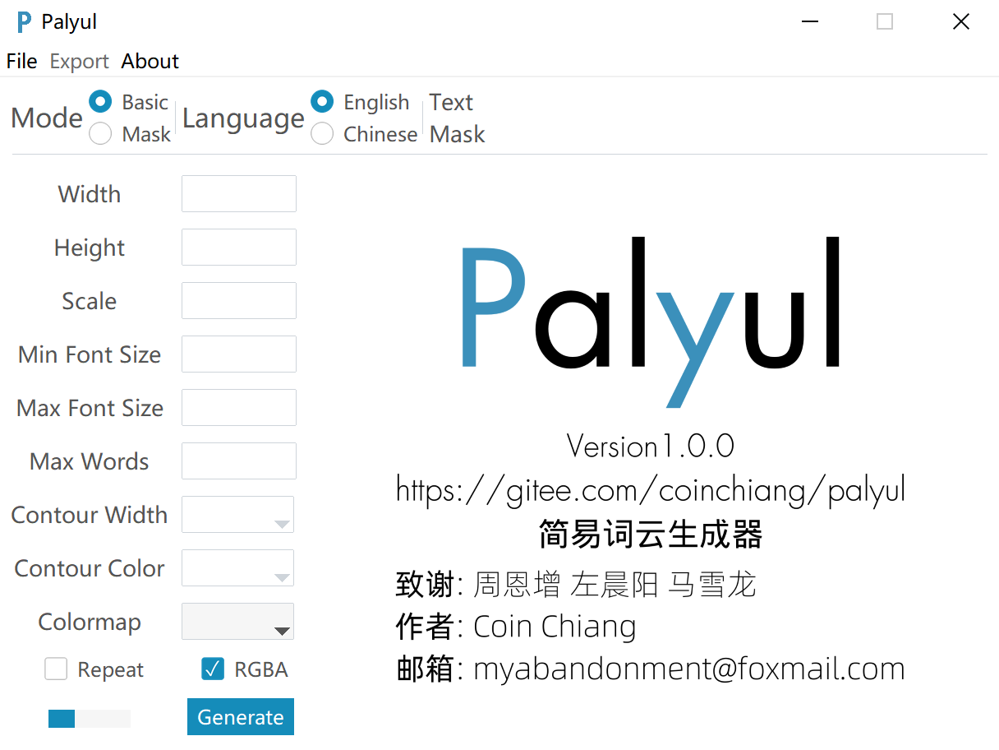

# Palyul

> **二次开发说明（Fork Notice）**
>
> 本仓库是基于原项目 [coinchiang/Palyul](https://gitee.com/coinchiang/palyul)（Gitee）的二次开发版本。
> - 原作者：**coinchiang**
> - 原许可证：**木兰宽松许可证，第 2 版（MulanPSL2）**，仓库中的 `LICENSE` 文件保持原样，未作任何修改
> - 本版本新增功能：Basic 模式下新增 `Shape` 选项，可选择 `Rectangle`（矩形）或 `Ellipse`（椭圆）词云
> - 改动文件：`src/model.py`、`src/controller.py`、`src/view.py`
>
> 完整的出处与致谢信息见 [NOTICE](NOTICE) 文件。

## 概览

Palyul是一个有图形化用户界面的词云生成器。


- 易用用户界面
- 支持中文分词
- 中文去停用词

词云生成调用[wordcloud](https://pypi.org/project/wordcloud/)包实现。中文分词调用[jieba](https://pypi.org/project/jieba/)包实现。



## 依赖

依赖包如下，其中有关pyinstaller的包非必须。

```
altgraph==0.17.4
contourpy==1.2.1
cycler==0.12.1
fonttools==4.53.0
jieba==0.42.1
kiwisolver==1.4.5
matplotlib==3.9.0
numpy==2.0.0
packaging==24.1
pefile==2023.2.7
pillow==10.3.0
pyinstaller==6.8.0
pyinstaller-hooks-contrib==2024.7
pyparsing==3.1.2
python-dateutil==2.9.0.post0
pywin32-ctypes==0.2.2
setuptools==70.1.0
six==1.16.0
ttkbootstrap==1.10.1
wordcloud==1.9.3
```

自动安装：

```shell
pip install -r requirements.txt
```

## 使用

### 方式一：运行源代码

下载源码并安装依赖包后：

```shell
python3 src/main.py
```

### 方式二：可执行文件

使用Pyinstaller打包了Windows可执行文件，可在Windows 10及更新系统使用。请参看本项目[发行版](https://gitee.com/coinchiang/palyul/releases)。

## 用法

- 加载文本->调整参数->[加载蒙版]->生成预览->导出词云
- `Basic`模式生成矩形词云，`Mask`模式基于蒙版图片生成词云
- `Basic`模式下可用`Shape`选项切换`Rectangle`（矩形）与`Ellipse`（椭圆）；`Mask`模式下形状由蒙版决定，该选项自动置灰
- 文本文件应为`txt`格式，蒙版图片应为`png`格式，导出图片为`png`格式

用户界面操作逻辑简单，选项具有自解释性，不再赘述。